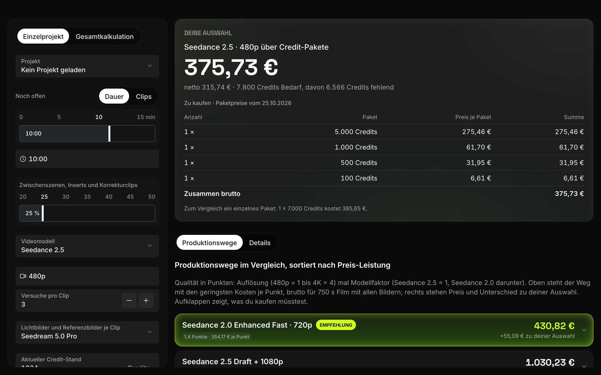
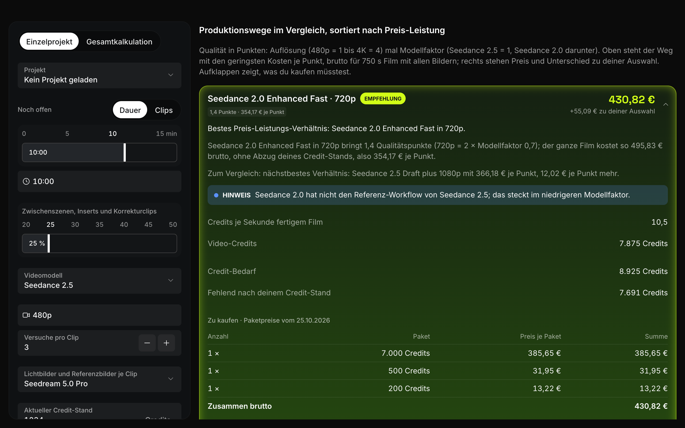

# Cost Calculator for Higgsfield

A Mac app that tells you what an AI film made with [Higgsfield](https://higgsfield.ai) will cost — in credits and in euros — before you generate it. It also tells you which credit packages to buy and ranks every production path (model × resolution) by price per quality.

> **Unofficial community project.** Not affiliated with, endorsed by or connected to Higgsfield. "Higgsfield" and "Seedance" are names of their respective owners and are used here only to describe what the calculator calculates. No Higgsfield logos, icons or images are included.



<sub>Screenshots show sample data. The interface is in German — see [Language](#language).</sub>

Built entirely with [Claude Code](https://claude.com/claude-code), and meant to be **rebuilt and adapted with Claude Code**: the repository contains not just the code but the full specification, calculation rules, build plan and decision log that Claude Code used to build it. Open the folder in Claude Code and it understands the whole project.

## Language

The app, its documentation and its code comments are in **German** (the author's language). Claude Code reads them fine in any language. If you want the app in English, ask Claude Code: *"Translate the user interface into English."*

## What it does


- **One number for your choice.** Enter what is still open in your film (duration or number of clips), the video model, resolution, attempts per clip, the image model for stills and references, and your current credit balance. The app shows the gross cost in euros, the credits you need and exactly which credit packages to buy.
- **Every production path compared.** All models and resolutions, ranked by cost per quality point, with the difference to your choice. Expand a row to see why it is recommended and what you would have to buy.

  
- **Multiple projects.** Save films as projects and add several of them up, counting your credit balance only once.
- **Three ways to use one calculation core:**
  - the **Mac app** (Tauri),
  - a **command line tool** `hfcalc`,
  - a local **MCP server**, so Claude Desktop, Claude Code and Codex can answer cost questions with the same numbers.

## Requirements

- macOS (the app window, install paths and setup are made for the Mac; Windows/Linux need adjustments that Claude Code can make)
- [Node.js 24](https://nodejs.org) and [pnpm](https://pnpm.io)
- [Rust](https://rustup.rs) and the Xcode command line tools (`xcode-select --install`) — needed to build the app
- Optional: the logged-in Higgsfield command line tool (`@higgsfield/cli`) to read your live credit balance; without it you type the balance in

## Quick start with Claude Code

1. Click **Use this template** on GitHub (or clone the repository).
2. Open the folder in Claude Code.
3. Ask: *"Read CLAUDE.md, run the tests, then build the app and install it."*

Then adapt it in conversation, for example: *"Add the new Seedance model with its prices"* or *"Change the default resolution to 720p."* Claude Code follows the rules in `CLAUDE.md` and the documents in `docs/`.

## Manual commands

```bash
pnpm install          # install dependencies
pnpm test             # run all tests
pnpm dev              # browser preview at http://localhost:1420/vorschau.html (sample data, no Mac app needed)
pnpm install:local    # set up data folder, hfcalc command and MCP server (see below)
pnpm tauri build      # build the Mac app into src-tauri/target/release/bundle/macos/
```

**What `pnpm install:local` changes on your Mac** (each existing file is backed up first, nothing is deleted):

- creates the data folder `~/Higgsfield-Kalkulator/` with the price data (never overwrites an existing one),
- installs `hfcalc` to `~/.local/bin/` and adds that folder to your `PATH` with one marked line in `~/.zshrc`,
- registers the MCP server in Claude Code, Claude Desktop and Codex.

## Prices go out of date

The price data reflects Higgsfield's prices **as of 25 October 2026**. Every price carries its date and source. Prices live in `~/Higgsfield-Kalkulator/preise/` after setup; `daten-vorlage/CLAUDE.md` explains how to update them (Claude Code can do it from a screenshot of Higgsfield's pricing). An unknown price is never treated as 0 — the app says "kein Preis hinterlegt" (no price stored) instead.

## How it was built

| File | What it contains |
|---|---|
| `CLAUDE.md` | The rules Claude Code follows in this project |
| `docs/SPEC.md` | Features and acceptance criteria |
| `docs/RECHENREGELN.md` | How costs are calculated, with test values |
| `docs/ARCHITECTURE.md` | Data model, interfaces, where things live on disk |
| `docs/UI-RULES.md` | Design and motion rules |
| `docs/BUILD-PLAN.md` | The step-by-step build plan |
| `docs/DECISIONS.md` | Every decision and fix along the way (personal details anonymised) |
| `start-prompt.md` | The prompt that started the build |

**Want to rebuild it from scratch instead?** Keep `CLAUDE.md`, `docs/` and `start-prompt.md`, delete the code, untick the checkboxes in `docs/BUILD-PLAN.md` and give Claude Code the start prompt. It will build the calculator step by step. Expect it to take much longer than adapting the finished version, and the result will differ in details.

## License

- Code and documentation: [MIT](LICENSE)
- Fonts Inter and Space Grotesk: SIL Open Font License 1.1 (`src/assets/fonts/*-OFL.txt`)
